<div align="center">

# Kilian Carasco — Portfolio

**Développeur Web & Software · Bachelor Concepteur Développeur d'Applications (EPSI Bordeaux)**

[](https://kiliandev.netlify.app/)
[](https://vador634.github.io/Portefolio/)


-654FF0?logo=webassembly&logoColor=white)


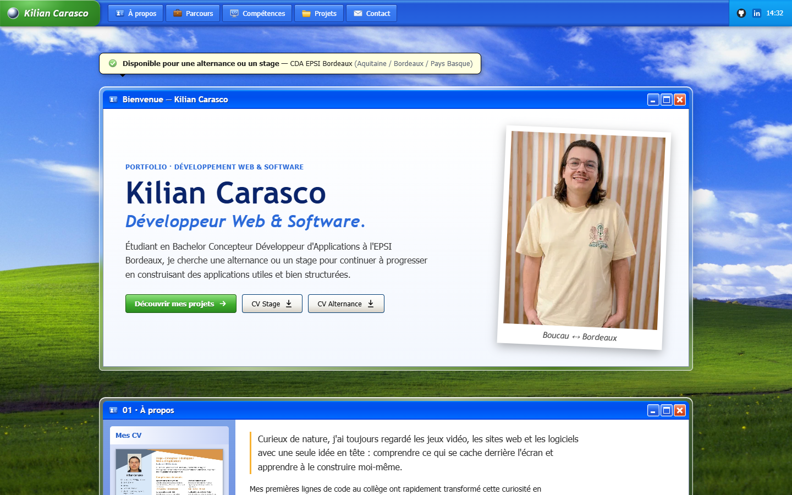

</div>

---

## Sommaire

1. [Le projet en bref](#1-le-projet-en-bref)
2. [Visite guidée en captures](#2-visite-guidée-en-captures)
3. [Choix techniques — et pourquoi](#3-choix-techniques--et-pourquoi)
4. [Architecture du dépôt](#4-architecture-du-dépôt)
5. [Comment ça marche](#5-comment-ça-marche)
6. [Qualité : accessibilité, SEO, performance, sécurité](#6-qualité--accessibilité-seo-performance-sécurité)
7. [Déploiement continu](#7-déploiement-continu)
8. [Lancer le projet en local](#8-lancer-le-projet-en-local)
9. [Évolution : de la v1 (2024) à aujourd'hui](#9-évolution--de-la-v1-2024-à-aujourdhui)
10. [Droits](#10-droits)

---

## 1. Le projet en bref

Ce dépôt contient le code source de mon portfolio, en ligne sur **[kiliandev.netlify.app](https://kiliandev.netlify.app/)**.

Je voulais un site qui soit **lui-même une démonstration** de ce que je sais faire, pas seulement une page qui le raconte :

| Objectif | Ce que j'ai fait |
|---|---|
| Se démarquer des portfolios « template » | Une interface complète inspirée de **Windows XP** : fenêtres, barre des tâches, volet de tâches, bulles de notification — entièrement en CSS et SVG, sans image d'interface. |
| Montrer mes vrais projets | La section Projets est **alimentée en direct par l'API GitHub** : un nouveau dépôt public apparaît automatiquement sur le site. |
| Montrer que je touche à plusieurs langages | Un **Démineur écrit en Python** tourne dans le navigateur grâce à **Pyodide (WebAssembly)** — c'est l'easter egg du site. |
| Être trouvable par les recruteurs | SEO soigné : balises Open Graph, données structurées `schema.org/Person`, `sitemap.xml`, `robots.txt`, Google Search Console. |
| Faire les choses proprement | Accessibilité (ARIA, navigation clavier, `prefers-reduced-motion`), en-têtes de sécurité stricts, déploiement continu. |

**En chiffres :** ~1 650 lignes écrites à la main · 5 fichiers de code · **0 framework · 0 dépendance npm · 0 étape de build**.

---

## 2. Visite guidée en captures

### Accueil
La fenêtre de bienvenue, la bulle « Disponible pour une alternance ou un stage » et la barre des tâches avec horloge en temps réel.


### À propos
Volet de tâches à gauche (CV téléchargeables, formations), texte de présentation à droite — exactement comme l'explorateur de fichiers de XP.

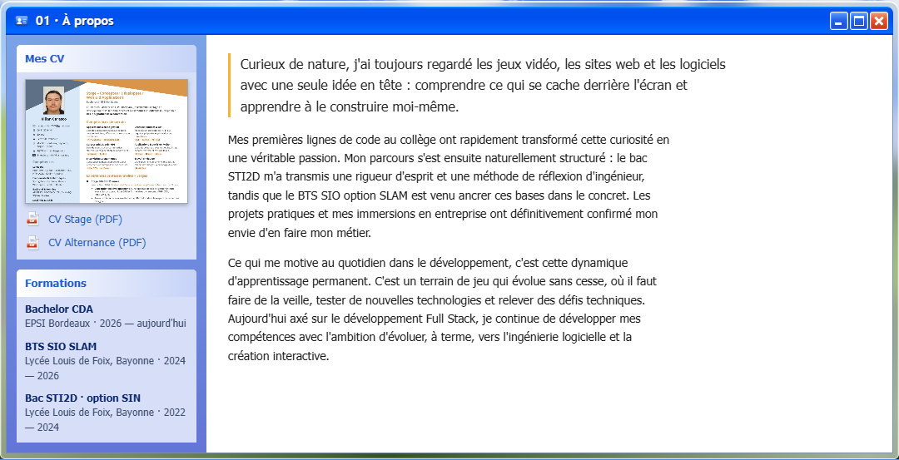

### Parcours & compétences
| Parcours | Compétences |
|---|---|
| 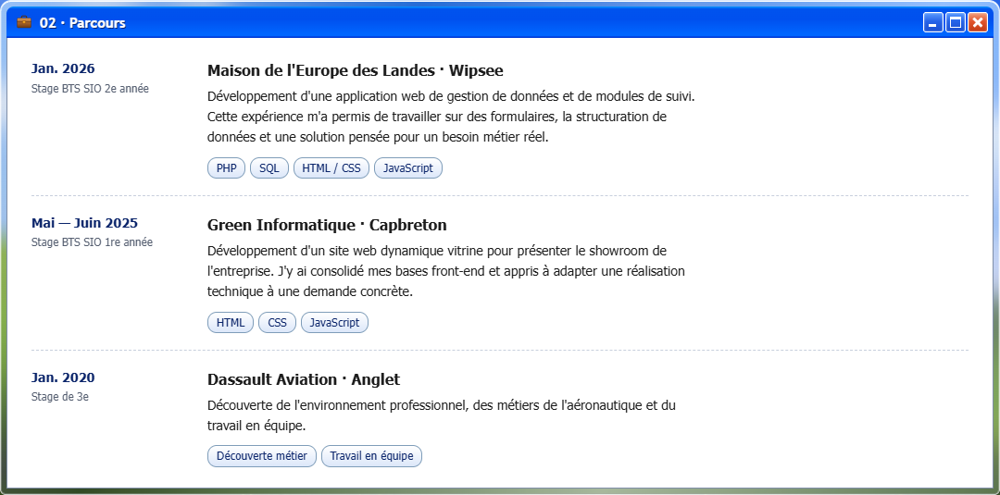 | 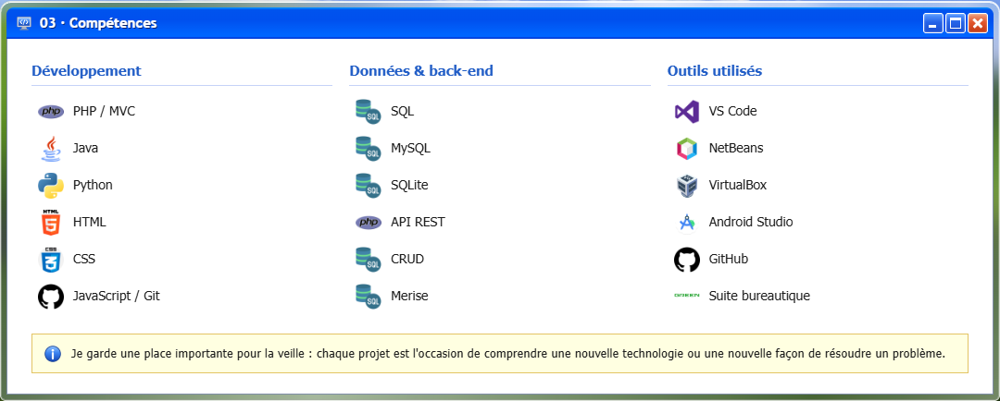 |

### Projets — chargés depuis l'API GitHub
Une « fenêtre d'explorateur » avec barre d'adresse, filtres par domaine ou par langage, et compteur d'objets dans la barre d'état.

| Tous les projets | Filtre « Python & données » |
|---|---|
| 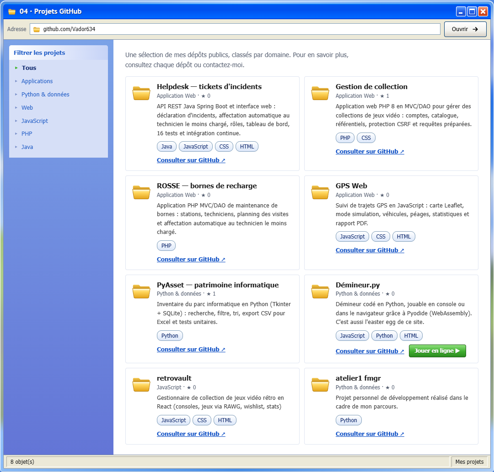 | 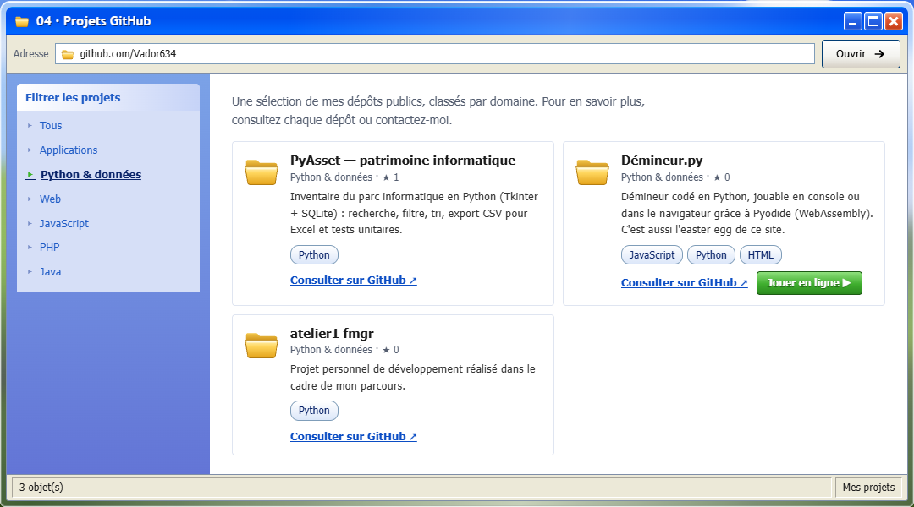 |

### Contact
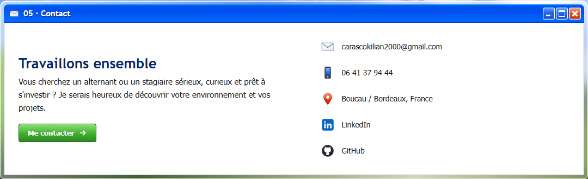

### L'easter egg : Démineur.py
Tapez le **code Konami** (`↑ ↑ ↓ ↓ ← → ← → B A`) ou cliquez sur la petite mine en bas de page : une fenêtre déplaçable s'ouvre, l'interpréteur Python se télécharge et le jeu démarre. Toute la logique du jeu est en Python ; JavaScript ne fait que l'affichage.

| Lancement par le code Konami | La fenêtre du jeu |
|---|---|
| 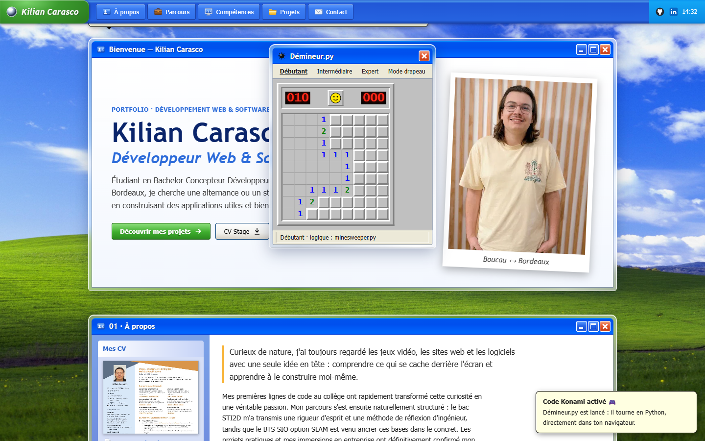 | 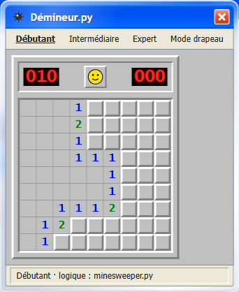 |

### Version mobile
Le site est entièrement responsive : la navigation devient un menu « hamburger » façon boutons XP.

| Accueil mobile | Menu ouvert |
|---|---|
| 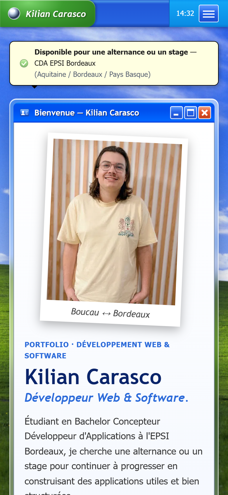 | 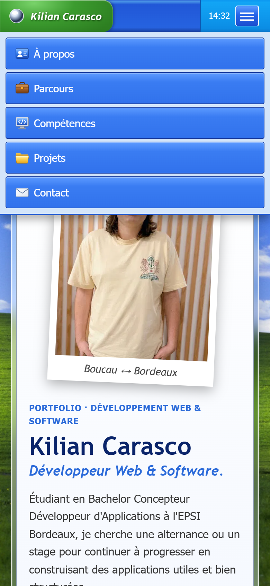 |

---

## 3. Choix techniques — et pourquoi

> Une explication détaillée et illustrée de chaque décision est disponible sur la page **[Coulisses du projet](https://vador634.github.io/Portefolio/)**.

| Technologie | Pourquoi ce choix | Alternative écartée |
|---|---|---|
| **HTML5 sémantique** | `header`, `nav`, `main`, `section`, `article`, `aside`, `footer`, `time`, `output`… Le balisage porte le sens, ce qui sert à la fois l'accessibilité et le référencement. | Un empilement de `div` |
| **CSS3 « vanilla »** | Tout le thème XP (dégradés des barres de titre, boutons, boîtes 3D du démineur) est recréé avec des **variables CSS**, `linear/radial-gradient`, Grid et Flexbox. Ça prouve que je maîtrise le CSS lui-même, pas seulement une librairie. | Bootstrap / Tailwind : impossible d'obtenir ce rendu sans tout surcharger. |
| **JavaScript natif (ES2022)** | `fetch` + `async/await`, `IntersectionObserver`, Pointer Events, Web Audio API, `localStorage`. Pour un site d'une page, un framework ajouterait du poids sans rien apporter. | React / Vue : je les utilise sur d'autres projets (ex. *RetroVault*), mais ici ce serait sur-dimensionné. |
| **SVG en sprite** | Toutes les icônes d'interface sont des `<symbol>` dans un seul sprite inline, réutilisés avec `<use>` : nets à toutes les tailles, colorables en CSS, **zéro requête réseau**. | Une police d'icônes ou des dizaines de PNG |
| **Python + Pyodide** | Je voulais montrer du Python *sur un site web*. Pyodide compile CPython en WebAssembly : le même fichier `minesweeper.py` se joue **en console** et **dans le navigateur**. Il n'est chargé qu'à l'ouverture du jeu. | Réécrire le jeu en JS (aucun intérêt démonstratif) |
| **API REST GitHub** | La liste des projets est toujours à jour sans que je touche au site ; je garde quand même la main sur l'ordre et les descriptions mises en avant. | Liste écrite en dur, vite périmée |
| **Netlify** | Hébergement statique sur CDN, HTTPS automatique, **déploiement à chaque `git push`**, redirections et en-têtes HTTP configurés dans un fichier versionné (`netlify.toml`). | GitHub Pages : pas d'en-têtes HTTP personnalisés |
| **Aucun outil de build** | Le code qui tourne en production est **exactement** celui du dépôt : lisible par n'importe quel recruteur directement sur GitHub. | Vite / Webpack |

---

## 4. Architecture du dépôt

```
Portefolio/
├── site/                         ← dossier publié par Netlify (= le site en ligne)
│   ├── index.html                  page unique : structure, sprite SVG, données schema.org
│   ├── css/
│   │   └── style.css               thème Windows XP complet + responsive
│   ├── js/
│   │   ├── script.js               projets GitHub, filtres, menu, horloge, Konami, sons
│   │   └── demineur.js             pont JavaScript ↔ Python (chargement Pyodide, rendu)
│   ├── py/
│   │   └── minesweeper.py          logique du Démineur (Python pur, jouable en console)
│   ├── assets/cv/                  CV en PDF + aperçu
│   ├── images/
│   │   ├── icons/                  logos des langages et outils
│   │   ├── photo/                  portrait
│   │   └── wallpaper/              fond d'écran
│   ├── favicon.svg · favicon-48.png · apple-touch-icon.png
│   ├── robots.txt · sitemap.xml    référencement
│   └── google….html                validation Google Search Console
├── docs/                         ← page « Coulisses du projet » (GitHub Pages) + captures
├── archive/v1-2024/              ← première version du portfolio, gardée pour montrer l'évolution
├── netlify.toml                  ← config de déploiement, redirections, en-têtes de sécurité
├── .editorconfig · .gitattributes · .gitignore
└── README.md
```

**Pourquoi séparer `site/` du reste ?** Seul le dossier `site/` est mis en ligne. La documentation, les captures et l'archive restent sur GitHub et ne sont jamais servies aux visiteurs du portfolio.

---

## 5. Comment ça marche

### Projets GitHub en direct (`js/script.js`)

```
Chargement de la page
   │
   ├─▶ GET api.github.com/users/Vador634/repos   (pagination automatique, 100 par page)
   │
   ├─▶ Filtrage : on écarte les forks, les dépôts vides et les dépôts de configuration
   │
   ├─▶ Tri : projets mis en avant d'abord, puis par taille, puis par date de mise à jour
   │
   ├─▶ GET …/languages pour chaque dépôt (en parallèle avec Promise.all)
   │
   └─▶ Classement automatique (Applications / Python & données / Web) puis affichage
```

- Toutes les données venant de l'API sont **échappées** (`cleanText`) avant d'être injectées dans le HTML : pas d'injection possible même si une description de dépôt contenait du HTML.
- Les liens « démo » ne sont acceptés que s'ils commencent par `https://`.
- Si GitHub ne répond pas, un message de repli propose un lien direct vers mes dépôts.

### Le Démineur : Python dans le navigateur (`js/demineur.js` + `py/minesweeper.py`)

```
Clic sur la mine / code Konami
   │
   ├─▶ Chargement de Pyodide depuis jsDelivr (uniquement à ce moment-là)
   ├─▶ fetch('py/minesweeper.py') puis écriture dans le système de fichiers virtuel de Pyodide
   ├─▶ pyimport('minesweeper').Demineur  → objet Python utilisable depuis JavaScript
   │
   └─▶ À chaque clic :  JS appelle  ouvrir(l, c) / drapeau(l, c) / accord(l, c)
                        Python renvoie l'état complet en JSON
                        JS redessine la grille
```

Points dont je suis fier :
- **Séparation stricte logique / affichage** : `minesweeper.py` ne sait pas qu'il tourne dans un navigateur. Le même fichier se lance avec `python minesweeper.py` dans un terminal.
- **Premier clic toujours sûr** : les mines ne sont placées qu'après le premier clic, en excluant la case et ses voisines.
- **Ouverture en cascade itérative** (pile) plutôt que récursive : pas de dépassement de pile sur la grille Expert 30×16.
- **« Accord »** (clic sur un chiffre) comme dans le vrai Démineur, **mode drapeau** et **appui long** sur mobile, **records** sauvegardés dans `localStorage`, sons générés avec la **Web Audio API** (aucun fichier audio).

### Petits détails d'interface
- L'onglet actif de la barre des tâches suit le défilement grâce à `IntersectionObserver`.
- Les boutons « réduire » des fenêtres fonctionnent vraiment.
- La fenêtre du Démineur se déplace à la souris (Pointer Events, bornée à l'écran).
- Un message est caché dans la console du navigateur pour les curieux.

---

## 6. Qualité : accessibilité, SEO, performance, sécurité

**Accessibilité**
- Chaque section est reliée à son titre (`aria-labelledby`), la grille de projets annonce ses changements (`aria-live`), le menu mobile expose son état (`aria-expanded`), les icônes décoratives sont masquées (`aria-hidden`).
- Navigation complète au clavier avec un focus visible ; la touche `Échap` ferme le jeu.
- Les animations sont coupées pour les personnes ayant activé `prefers-reduced-motion`.

**Référencement**
- `title` et `meta description` rédigés, balise `canonical`, Open Graph et Twitter Card (aperçu propre quand le lien est partagé sur LinkedIn).
- Données structurées `schema.org/Person` pour que les moteurs comprennent qui je suis.
- `sitemap.xml`, `robots.txt` et site validé dans Google Search Console.

**Performance**
- Aucune librairie chargée au démarrage : le seul gros téléchargement (Pyodide) n'a lieu que si on lance le jeu.
- Images sous le pli en `loading="lazy"`, portrait en `fetchpriority="high"`, dimensions déclarées pour éviter les sauts de mise en page.
- Scripts en `defer`, icônes dans un sprite SVG inline (aucune requête).

**Sécurité** (voir `netlify.toml`)
- **Content-Security-Policy stricte** : seuls le site lui-même, l'API GitHub et jsDelivr (Pyodide) sont autorisés. Aucun script inline, aucun `eval` (seul `wasm-unsafe-eval`, nécessaire à WebAssembly).
- `X-Frame-Options: DENY` et `frame-ancestors 'none'` contre le clickjacking, `X-Content-Type-Options: nosniff`, `Referrer-Policy`, `Permissions-Policy` (caméra, micro, géolocalisation désactivés).
- Les CV ne sont pas indexés par les moteurs (`X-Robots-Tag: noindex`).
- Aucun secret, aucune clé d'API : l'API GitHub publique est appelée sans authentification.

---

## 7. Déploiement continu

```
git push sur main  ──▶  Netlify détecte le commit  ──▶  publie le dossier site/  ──▶  kiliandev.netlify.app
```

- Pas de commande de build : Netlify publie directement le dossier `site/` (voir `netlify.toml`).
- Chaque *pull request* obtient automatiquement une **URL de prévisualisation** avant d'être fusionnée.
- Les anciennes URLs des CV redirigent (301) vers les nouvelles : les liens déjà envoyés aux recruteurs continuent de fonctionner.

---

## 8. Lancer le projet en local

Aucune installation n'est nécessaire. Il faut seulement un petit serveur HTTP (le Démineur charge `minesweeper.py` avec `fetch`, ce qui ne fonctionne pas en ouvrant le fichier directement) :

```bash
git clone https://github.com/Vador634/Portefolio.git
cd Portefolio/site
python -m http.server 8000
# puis ouvrir http://localhost:8000
```

Ou avec l'extension **Live Server** de VS Code, sur le dossier `site/`.

Jouer au Démineur dans le terminal :

```bash
python site/py/minesweeper.py
```

---

## 9. Évolution : de la v1 (2024) à aujourd'hui

Mon tout premier portfolio, réalisé en première année de BTS SIO, est conservé dans [`archive/v1-2024/`](archive/v1-2024/). Je l'ai gardé volontairement : il montre d'où je pars.

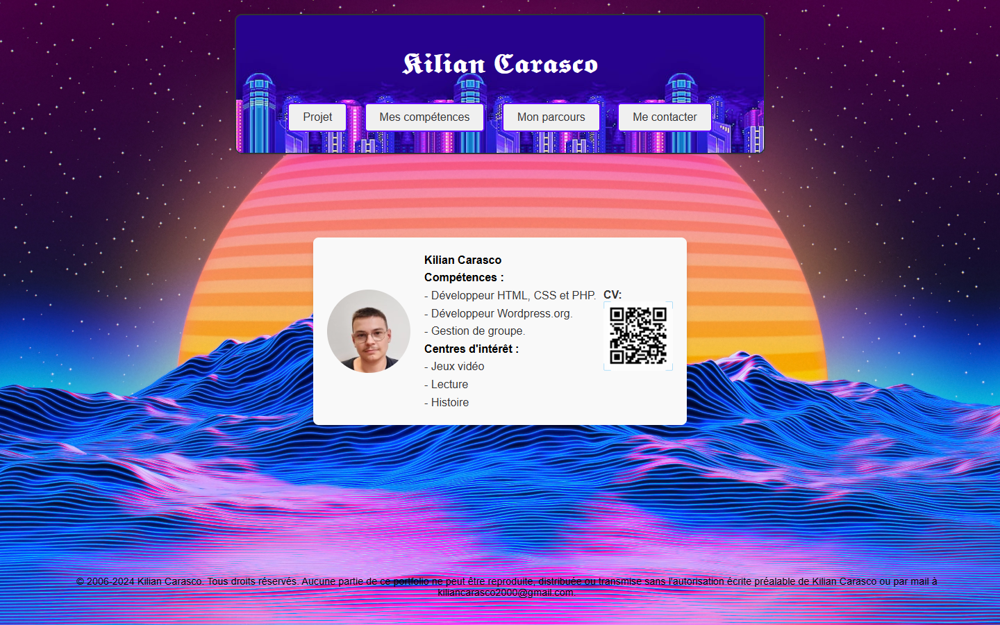

| | v1 — 2024 | Version actuelle |
|---|---|---|
| Structure | 7 pages HTML séparées, en-tête copié-collé dans chacune | 1 page, sections ancrées, aucun code dupliqué |
| Style | Une feuille CSS de base, mise en page en positions fixes | Thème complet avec variables CSS, Grid, Flexbox, responsive |
| JavaScript | Aucun | Données en direct (API), interactions, jeu, sons |
| Projets | Pages « placeholder » | Récupérés automatiquement depuis GitHub |
| Accessibilité / SEO | Non traités | ARIA, clavier, Open Graph, schema.org, sitemap |
| Mise en ligne | Fichiers locaux | Déploiement continu Netlify + en-têtes de sécurité |

---

## 10. Droits

© 2026 Kilian Carasco — Tous droits réservés.
Le code est public pour être **lu et évalué** (recruteurs, jury, curieux). Les textes, visuels, photos et le CV ne peuvent pas être réutilisés sans mon autorisation.

**Me contacter :** via la [section Contact du site](https://kiliandev.netlify.app/#contact) ou sur [LinkedIn](https://www.linkedin.com/in/kilian-carasco-029915399/).
