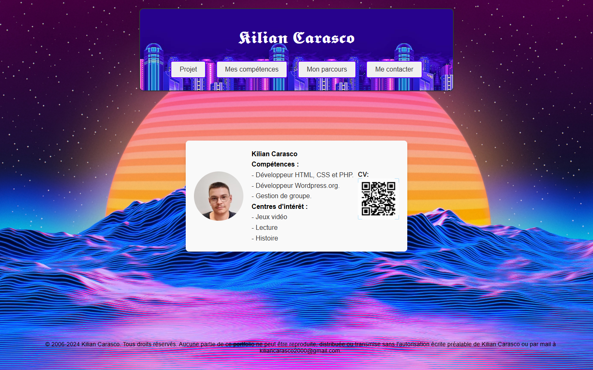

# Archive — première version du portfolio (septembre 2024)

Ce dossier contient **mon tout premier portfolio**, réalisé au début de ma première année de BTS SIO.
Il n'est plus en ligne : je le conserve volontairement dans le dépôt pour montrer **le chemin parcouru** jusqu'à la version actuelle (dossier [`site/`](../../site/)).

## Ce que contenait la v1

| Fichier | Rôle |
|---|---|
| `html1.html` | Page d'accueil (carte de présentation + QR code) |
| `Projet.html`, `Projet2.html`, `Projet3.html` | Projets scolaire, personnel et professionnel (contenu provisoire) |
| `compétence.html`, `Parcours.html`, `contacte.html` | Compétences, parcours, contact |
| `styles.css` | Feuille de style commune (fond synthwave, boutons de navigation) |

## Ce que j'en retiens

- **Code dupliqué** : l'en-tête et la navigation étaient copiés dans les 7 pages. → Aujourd'hui : une seule page avec des sections ancrées.
- **Mise en page en positions fixes** : le site cassait sur mobile. → Aujourd'hui : Grid, Flexbox et media queries.
- **Contenu statique** : les projets étaient écrits à la main (et jamais terminés). → Aujourd'hui : ils sont chargés automatiquement depuis l'API GitHub.
- **Aucune attention à l'accessibilité, au référencement ni à la sécurité.** → Aujourd'hui : ARIA, Open Graph, schema.org, Content-Security-Policy.

> Le CV de l'époque a été retiré de l'archive : il contenait des informations personnelles qui n'ont pas à être publiques.
